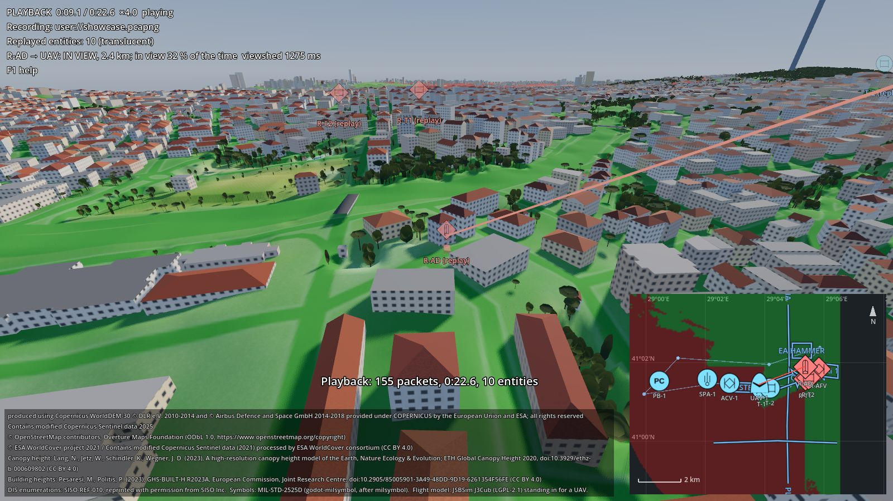

# godot-sim-demo

One Godot 4 scene that uses four open source simulation add-ons together: a UAV-like aircraft flies a waypoint route
on autopilot over Üsküdar and the Bosphorus in Istanbul (terrain, buildings, trees, roads and water from open data),
publishes itself on a DIS network, land units drive on the streets and a patrol boat on the water, a 2D tactical map
shows military symbols and control measures, an air defence post keeps a line of sight on the aircraft past hills
and buildings, and the DIS traffic is recorded and played back. The units and the exercise are imaginary.

> **Status:** in development, not released yet. It follows the add-ons' v0.1.0 work.


<sub>Buildings, roads and water © OpenStreetMap contributors, Overture Maps Foundation (ODbL 1.0). Contains modified
Copernicus Sentinel data 2025. Elevation produced using Copernicus WorldDEM-30 © DLR e.V. 2010-2014 and © Airbus
Defence and Space GmbH 2014-2018 provided under COPERNICUS by the European Union and ESA; all rights reserved. Land
cover © ESA WorldCover project 2021 (CC BY 4.0). Canopy height: ETH Global Canopy Height 2020, Lang et al. 2023
(CC BY 4.0). Building heights: GHS-BUILT-H R2023A, European Commission JRC (CC BY 4.0).</sub>

## What it shows

| Part | Add-on | In the scene |
|---|---|---|
| Flight dynamics | godot-jsbsim | `JSBSimAircraft` with the J3Cub model standing in for a UAV, flown by `JSBSimAutopilot` around a loop of six waypoints over the Bosphorus and the Çamlıca hills, each 180 m above the highest building, tree or ground on the leg to it; the terrain is the aircraft's ground. |
| Terrain | godot-geo | `GeoTerrain` package of Üsküdar (10 × 10 km at 5 m: Copernicus DEM, Sentinel-2, OpenStreetMap buildings, roads and water, ESA WorldCover ground detail, ETH canopy trees), in the same local frame as DIS and JSBSim; the 60 × 60 km package of the same area can be chosen with `--terrain 60km`. |
| DIS | godot-dis | `DisNetwork` (multicast 239.1.2.3, exercise 1), a `DisEntity` on the aircraft, on each land unit (driving on the streets, heights from `GeoTerrain.height_at`) and on a patrol boat on the sea surface, `DisEntityManager` for entities of other simulations on the same exercise. |
| Line of sight | godot-geo | `line_of_sight` from the opposing air defence post to the UAV five times a second on a worker thread; terrain, buildings and tree crowns block (red: in view, yellow: up to what hides it). `V` computes the viewshed for the UAV's height above ground on a worker thread and draws it on the terrain and the map. |
| Tactical map | godot-milsymbol | `TacticalMap2D` with MIL-STD-2525D symbols (from the DIS entity types), a phase line, boundary, axis of advance, objective, named area of interest and engagement area, the route, the track and the line of sight. |
| Record and playback | godot-dis | `R` records the DIS traffic with `DisRecorder` (pcapng, opens in Wireshark); `P` plays it back with `DisPlayer` into a separate entity manager: the replayed units appear translucent in 3D and on the map, with speed, pause and seek. |



## Requirements
- Godot 4.7.x (Windows or Linux x86-64; desktop, Forward+ renderer). Tested with 4.7.2 on Windows 11 and Ubuntu 24.04.
- The four add-ons: godot-dis, godot-geo, godot-jsbsim, godot-milsymbol (v0.1.0, pinned in `addons.json`).
- The Üsküdar terrain package from the godot-geo release (`terrain/uskudar_10km`, 21 MB download, 20 MB unpacked);
  optionally the 60 × 60 km package (`terrain/uskudar`, 245 MB download, 234 MB unpacked, about 1.3 GB of video
  memory).
- Python 3.8+ for the setup scripts (standard library only), or unpack the release zips by hand.
- A GPU with Vulkan. Frame times measured at 1920 × 1080 on an RTX 4080 (Windows 11, vsync off, one lap of the route
  at 8× with the camera following the UAV over the city):

  | Terrain | Median | 95th percentile | 99th percentile |
  |---|---|---|---|
  | `uskudar_10km`, all layers (default) | 2.8 ms (360 fps) | 3.7 ms | 5.6 ms |
  | `uskudar_10km`, `--no-layers` | 2.1 ms (480 fps) | 3.7 ms | 4.2 ms |
  | `uskudar` (60 km), all layers | 4.2 ms (240 fps) | 11.9 ms | 21.7 ms |

  `<godot> --path . --resolution 1920x1080 -- --no-vsync --time-scale 8 --seconds 540` prints the same line for
  your machine.

## Installation
The add-ons and the terrain are not in this repository. [docs/getting-started.md](docs/getting-started.md) walks
through the whole setup; in short:

```sh
git clone https://github.com/OWNER/godot-sim-demo.git
cd godot-sim-demo
python tools/fetch_addons.py --godot <path to the Godot executable>
```

`tools/fetch_addons.py` downloads the add-ons' release zips and the terrain package pinned in `addons.json`, unpacks
them into `addons/` and `terrain/` and imports the project once. To work on the add-ons themselves, link the sibling
repositories instead with `tools/link_addons.py`. Both ways, and why the add-ons are not git submodules:
[docs/addons.md](docs/addons.md).

## Usage
```sh
godot --path .
```
`demo/main.tscn` checks that the add-ons and the terrain are there and opens `demo/showcase.tscn`.

| Key | |
|---|---|
| Tab / Shift+Tab | camera on the next / previous unit (UAV first) |
| Left drag, wheel | orbit, zoom (over the map: pan, zoom the map) |
| `[` `]` | simulation slower / faster (up to 16×) |
| V | viewshed of the air defence post |
| M | large / small map |
| R | start / stop recording (`user://showcase.pcapng`) |
| P | playback of the last recording / back to live; in playback Space, Left / Right (10 s), Up / Down (speed), Home |
| F1, F12, Esc | help, screenshot, quit |

Command line options (after `--`):

| Option | |
|---|---|
| `--port N` | DIS port (default 3000) |
| `--terrain PACKAGE` | `10km` (default, `res://terrain/uskudar_10km`), `60km` (`res://terrain/uskudar`) or a package folder |
| `--no-layers` | terrain without buildings, trees and roads (slower computers) |
| `--no-vsync` | draw as fast as possible; the frame times are printed at the end of every run |
| `--time-scale X` | simulation speed |
| `--record FILE`, `--replay FILE` | record from the start; open a recording in playback mode |
| `--viewshed` | start with the viewshed on |
| `--seconds N`, `--screenshot FILE` | quit after N game seconds (in playback: recording seconds), save a screenshot first |
| `--tour` | press the keys of a 44 s tour by itself (fast-forward, viewshed, map, view from the post, playback) |
| `--capture DIR` | with `--tour`: save the screen as PNG frames and quit at the end ([docs/media.md](docs/media.md)) |
| `--check N`, `--report FILE` | self-test, see below |

The demo joins DIS exercise 1 on multicast 239.1.2.3 like the add-ons' own demos, so with the same `--port` the
godot-dis 2D demo shows the UAV and the units, and their entities appear here on the map's Remote layer.

## Demos
- `demo/showcase.tscn`: the scene above (opened by `demo/main.tscn`).
- Scenario data (units, route, control measures) is in `demo/scenario.gd`. `tools/probe_heights.gd` prints terrain
  heights; `tools/probe_route.gd` prints how much of the route the air defence post can see, or scans a grid for
  post positions (buildings and trees block, as in the scene), for laying out your own scenario.

## Documentation
- [docs/getting-started.md](docs/getting-started.md): from a clean machine to the running showcase.
- [docs/addons.md](docs/addons.md): where the add-ons come from (release zips or sibling repositories).
- [docs/media.md](docs/media.md): how the animation and the social preview image are made.

Each add-on documents its own API: godot-dis (`docs/entities.md`, `docs/recording.md`), godot-geo
(`docs/geo-terrain.md`), godot-jsbsim (`docs/autopilot.md`), godot-milsymbol (`docs/tactical-map.md`).

The UAV uses the J3Cub flight model because it is the only aircraft bundled with godot-jsbsim (its licence history
is clean); the look is a simple UAV model, the performance that of a light aircraft (75 kt, ~2.6 m/s climb).

## Development
Self-test (headless, a few minutes of game time at 8×, exit code 0 when every check passes):

```sh
godot --headless --path . -- --check 480 --report check.json
```

It flies the route while recording, then plays the recording back and checks: the flight model ran without crash,
the autopilot reached waypoints and kept above the terrain, buildings and trees, every entity was published on DIS,
the land units' and the boat's DIS positions (ECEF, converted back with godot-geo `GeoMath`) lie on the ground or the
water, the line of sight and viewshed answers are plausible, the map holds all units and control measures, and every
entity is replayed near its live position.
It uses port 3290 unless `--port` is given, so it does not disturb running demos. Without a window the buildings,
trees and roads are not drawn; the visibility queries still read their data from the package.

## Contributing
See [CONTRIBUTING.md](CONTRIBUTING.md). Participation is governed by the [code of conduct](CODE_OF_CONDUCT.md).

## License
MIT, see [LICENSE](LICENSE). The add-ons and the data they ship have their own notices; see
[THIRD_PARTY_NOTICES.md](THIRD_PARTY_NOTICES.md).
