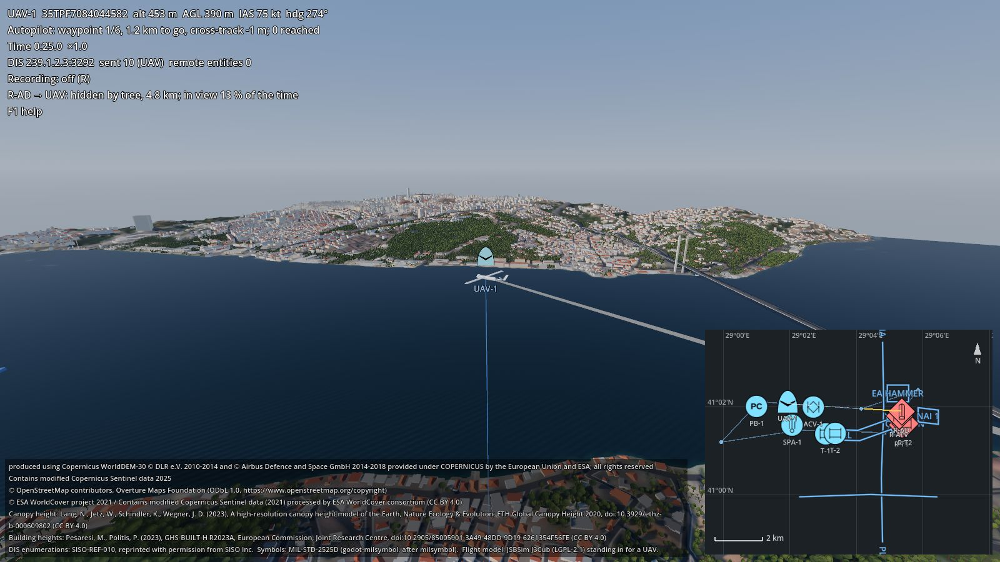

# Getting started

From nothing to the running showcase in about 15 minutes: install Godot, clone this repository, let one script
download the four add-ons and the terrain, open the scene. Most of the time goes into downloads (Godot ~70 MB, the
add-ons and terrain ~35 MB).



## What you need
- **Windows 10/11 or Linux** (x86-64) with a GPU that runs Vulkan (the Forward+ renderer). macOS is not tested yet.
- **Godot 4.7.2**, the standard build (not .NET). Download it from
  [godotengine.org/download/archive/4.7.2-stable](https://godotengine.org/download/archive/4.7.2-stable/) and unzip
  it anywhere. Godot is a single executable; no installer.
- **git** and **Python 3.8 or newer** (only the standard library is used).
- About 300 MB of disk space (the Godot zip and the download cache `.cache/` can be deleted afterwards).

On Linux, from a terminal:
```sh
mkdir -p ~/godot && cd ~/godot
curl -LO https://github.com/godotengine/godot/releases/download/4.7.2-stable/Godot_v4.7.2-stable_linux.x86_64.zip
unzip Godot_v4.7.2-stable_linux.x86_64.zip && chmod +x Godot_v4.7.2-stable_linux.x86_64
cd ~
```
On Windows, download `Godot_v4.7.2-stable_win64.exe.zip` from the same release page and unzip it, for example to
`C:\godot`.

In the commands below, replace `<godot>` with the full path of the Godot executable, for example
`~/godot/Godot_v4.7.2-stable_linux.x86_64` or `C:\godot\Godot_v4.7.2-stable_win64_console.exe` (on Windows use the
`_console` one for command line runs: it shows the output).

## 1. Clone
In a terminal, go to the folder that should hold the project, then:
```sh
git clone https://github.com/OWNER/godot-sim-demo.git
cd godot-sim-demo
```

## 2. Get the add-ons and the terrain
```sh
python3 tools/fetch_addons.py --godot <godot>
```
On Windows the Python command is usually `py` instead of `python3`.

> Until the add-on repositories are published, the script stops with a note about the placeholder owner `OWNER`.
> If you have the release zips in a folder, add `--mirror <folder>` to take them from there.

The script downloads five release files (pinned in `addons.json`), unpacks them into `addons/` and `terrain/`, and
prints one line per file, for example `addons/dis <- godot-dis 0.1.0 godot-dis-0.1.0.zip (sha256 3a8c...)` (the
checksum is printed while `addons.json` does not pin one yet). Then it imports the
project once so Godot registers the add-ons: about a hundred lines of Godot's own progress output follow
(`first_scan_filesystem`, `update_scripts_classes`, `reimport`, `loading_editor_layout`, ...). No window opens. The
script's last line is `fetch_addons: done, 5 of 5 packages in place`. If a download breaks off, run it again;
finished downloads are kept in `.cache/`. [addons.md](addons.md) explains the files and how to get them without the
script.

Check that everything is in place (Linux; on Windows `dir addons terrain\uskudar_10km`):
```sh
ls -d addons/dis addons/geo addons/jsbsim addons/milsymbol terrain/uskudar_10km/terrain.json
```

The larger 60 × 60 km package of the same area (245 MB download, about 1.3 GB of video memory) is optional:
`python3 tools/fetch_addons.py --all` adds it as `terrain/uskudar`, and `<godot> --path . -- --terrain 60km` uses
it.

## 3. Run
```sh
<godot> --path .
```
A 1600 × 900 window opens over Üsküdar on the Asian shore of the Bosphorus in Istanbul: a small UAV flying a loop
of six waypoints over the water and the Çamlıca hills, land units of two sides on the streets, a patrol boat on the
Bosphorus, and a tactical map in the lower right corner. Buildings, trees and roads stream in around the camera
during the first seconds. The red air defence post (R-AD on the map) east of the Çamlıca hills watches the UAV: its
line of sight is red while it can see the UAV, and yellow up to the hill, building or tree that hides it (then
dashed on the map). For most of the first three minutes the UAV is over the Bosphorus, hidden behind the hills;
press `]` a few times to get to the eastern part of the loop sooner. The data attributions are at the bottom left. The units,
the post and the exercise are imaginary.

The demo publishes its units on the network from the start (DIS on UDP multicast `239.1.2.3`, port 3000); step 5
says more. On Linux, the console lines about `libasound` / `libpulse` and "All audio drivers failed" are harmless (no
sound system; the demo has no sound). Under WSL the picture is drawn in software and runs slowly; see
Troubleshooting.

Things to try:

| Key | |
|---|---|
| `]` (a few times) | speed the simulation up to 16× |
| Tab | camera on the next unit; left drag orbits, the wheel zooms |
| V | viewshed: what the air defence post can see at the UAV's height above ground (green: in view, red: hidden; on the terrain and the map) |
| M | large map; drag to pan, wheel to zoom |
| R, then R again after a minute | record the DIS traffic |
| P | play the recording back (translucent units); Space, Left / Right, Up / Down; P again returns to live |
| F1 | all keys |

If the window shows "godot-sim-demo cannot start" instead, it lists what is missing; see Troubleshooting below.

## 4. Check the installation (optional)
The self-test flies the route at 8× for 480 game seconds without a window (a few minutes), records and
replays the DIS traffic, and checks every add-on's part:
```sh
<godot> --headless --path . -- --check 480
```
A line starting with `SHOWCASE_CHECK ok` near the end, and exit code 0, mean that all checks passed. The run
records to `user://showcase_check_<port>.pcapng` and writes its report to `user://showcase_check.json` (`--report`
chooses another file).

## 5. See it on the DIS network (optional)
The demo publishes the UAV and the ground units as DIS Entity State PDUs on multicast `239.1.2.3`, port 3000,
exercise 1. Wireshark (filter `dis`) shows them, and any DIS tool on the same port and exercise sees the entities.
Options of the demo come after `--` on the command line, for example
`<godot> --path . -- --port 3001 --record run.pcapng` (another port; record from the start). The README lists all
options.

## Troubleshooting
- **"godot-sim-demo cannot start: ... is missing"**: the add-on or terrain folder is not there. Run step 2 again and
  look at its output; a folder that already exists is skipped (add `--force` to unpack again).
- **"... is present but its library did not load"**: the C++ add-on has no library for your platform or the import
  did not run. Run `<godot> --headless --path . --import` once. On Linux, `ldd addons/jsbsim/bin/linux/*.so` shows
  missing system libraries.
- **Script errors about unknown classes (`DisNetwork`, `JSBSimAircraft`, `GeoTerrain`)** on the first run: the
  project was opened before the import; run `<godot> --headless --path . --import` once.
- **Black window or Vulkan errors**: update the GPU driver. As a test, `<godot> --path . --rendering-driver opengl3`
  starts with OpenGL (slower, but it shows whether the problem is the driver).
- **Messages about `libasound` / `libpulse` and "All audio drivers failed"** (Linux): no sound system; harmless, the
  demo has no sound.
- **WSL 2:** it runs under WSLg, usually with software rendering (`llvmpipe` in the first lines of the output), so
  slowly; the self-test is not affected.
- **Slow picture on an older GPU:** `<godot> --path . -- --no-layers` leaves out the buildings, trees and roads.
- **Windows firewall prompt** on the first start: DIS uses UDP; allowing private networks is enough for the demo.
- **No DIS traffic in other tools**: they must use the same port and exercise; on some networks multicast is
  blocked, the demo itself works without it.

## Next steps
- [README](../README.md): what each add-on contributes, all keys and command line options.
- `demo/scenario.gd`: units, route and control measures; change them and run again.
- The add-ons' own documentation: godot-dis, godot-geo, godot-jsbsim and godot-milsymbol each have a `docs/` folder.
- [addons.md](addons.md): working on an add-on and seeing the change here (sibling repositories).
